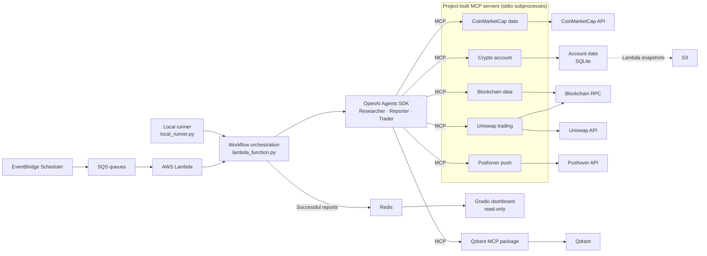

# Crypto Trader

Crypto Trader is a Python application for researching digital assets, reporting
on cryptocurrency accounts, and running an AI-assisted trading workflow. It
combines language-model agents with market-data, account, and blockchain tools
served through the Model Context Protocol (MCP). An AWS Lambda handler runs
the trading or reporting workflow. The separate Gradio frontend reads reporter
snapshots from Redis and presents account holdings, portfolio history,
transactions, and activity logs.

The project is an experimental trading and research tool, not financial advice.
Market data may be delayed or incomplete, and model-generated analysis can be
wrong. Trading and token approvals can move or expose real funds. Run it only
with accounts and keys you are prepared to use, and supervise any live trading.

## Capabilities

- **Research:** retrieve cryptocurrency metadata, current listings, and
  historical market data through CoinMarketCap.
- **Account reporting:** inspect accounts, holdings, transactions, and activity
  and generate structured portfolio reports.
- **Valuation history:** on each successful report, the reporter retrieves
  prior portfolio snapshots from the Qdrant knowledge database, stores a new
  timestamped valuation, and includes the available history in the report.
- **Portfolio dashboard:** launch a Gradio UI with account summaries, holdings,
  portfolio-value charts, transaction tables, and logs.
- **Backend/frontend boundary:** the backend stores successful `ReporterOutput`
  objects as JSON in the Redis `accounts` hash, keyed by account name. A later
  successful report replaces that account's previous value. The Gradio app
  reads this hash and does not invoke the backend.
- **AI-assisted trading:** query Uniswap for swap routes and quotes, inspect
  allowances, create token approvals, and submit swaps through configured
  blockchain services.
- **Agent memory and traces:** use SQLite-backed agent sessions, local account
  storage, Qdrant-backed research memory, and file-based trace logging.
- **Optional notifications:** send push notifications through Pushover when
  that integration is configured.

## Technology

- Python 3.12 or newer, managed with [uv](https://docs.astral.sh/uv/)
- [OpenAI Agents SDK](https://github.com/openai/openai-agents-python) using
  OpenRouter's OpenAI-compatible API
- [MCP](https://modelcontextprotocol.io/) with Python MCP servers for research,
  accounts, trading, blockchain data, and notifications
- Gradio for the web UI; Pandas and Plotly for portfolio tables and charts
- Redis for sharing reporter output between the Lambda backend and Gradio app
- Boto3 and S3 for deployed account-database snapshots
- CoinMarketCap API for cryptocurrency data
- Uniswap APIs, Web3.py, and Ethereum account tooling for swap workflows
- SQLite for local account data and agent sessions; S3 snapshots for the Lambda
  account database; Qdrant for vector memory

## Requirements

- Python 3.12+
- [uv](https://docs.astral.sh/uv/getting-started/installation/) with `uvx`
- A Redis instance reachable by both applications
- A Qdrant server reachable by the backend; local development can start one
  with Docker
- API credentials for whichever integrations you plan to use
- A compatible Ethereum RPC endpoint and correctly configured wallet for
  blockchain or swap features

The application can start without every optional integration configured, but
the associated feature will not work until its service and credentials are
available.

## Setup

1. Clone the repository and enter its directory:

   ```bash
   git clone https://github.com/anton-kovachev/crypto_trader.git
   cd crypto_trader
   ```

2. Create your local environment file:

   ```bash
   cp .env.example .env
   ```

   Edit `.env` and fill in credentials for the features you intend to use.
   `.env` is excluded from Git. Never commit API tokens, wallet addresses that
   you consider private, or private keys.

3. Install the project dependencies:

   ```bash
   uv sync
   ```

4. Start Redis and Qdrant locally. Set `REDIS_URL` and `QDRANT_URL` in `.env`.

5. Generate a report locally to populate Redis with the account's latest report
   and valuation history:

   ```bash
   uv run python local_runner.py reporting
   ```

6. Start the dashboard:

   ```bash
   uv run python local_runner.py ui
   ```

   Open the local URL printed by Gradio in your browser.

The dashboard only reads from Redis. It does not start agents, call the
backend, or start Qdrant. The local trading-floor runner can start Qdrant with
Docker if it cannot connect to `127.0.0.1:6333`.

## Running workflows locally

Use the local helper to run one trading cycle, generate and persist a report,
or launch the dashboard. The optional `--run-every-n-seconds N` parameter
controls repetition for that command (`--run_every_n_seconds` is an alias).
Omit it or set it to `0`/`none` for a one-time trading or reporting run:

```bash
# One-time runs
uv run python local_runner.py trading
uv run python local_runner.py reporting
uv run python local_runner.py reporting --run-every-n-seconds 0
uv run python local_runner.py ui --run-every-n-seconds none

# Independent repeating processes; run each in its own terminal
uv run python local_runner.py trading --run-every-n-seconds 300
uv run python local_runner.py reporting --run-every-n-seconds 3600
uv run python local_runner.py ui --run-every-n-seconds 15
```

A positive value repeats trading or reporting after that many seconds have
elapsed since the previous run completed. Run each command in its own terminal
to give the workflows independent intervals. Press Ctrl+C to stop a repeating
command.

The UI launches one Gradio server. A positive interval controls how often its
account cards refresh from Redis; `0`/`none` disables automatic refresh. The
server remains running until stopped.

Trading can submit on-chain transactions. Use a dedicated test account and
network.

## AWS deployment

The Terraform stack deploys the Lambda backend and Gradio UI as separate ZIP
packages. EventBridge Scheduler sends trading and reporter events to separate
SQS queues; the backend Lambda consumes both queues. The backend loads the
SQLite account database from S3 into `/tmp` for each invocation and saves it
back afterward. Successful reports are stored as JSON in the Redis `accounts`
hash, keyed by account name; the UI reads reports from Redis and does not call
the backend.

1. Configure AWS CLI credentials for `eu-north-1`, Terraform, and `uv`. Build
   the ZIP packages on Linux x86_64 with Python 3.12.
2. Create the backend credentials as a JSON Secrets Manager secret and set up
   an externally reachable Qdrant endpoint. See the required keys in
   [terraform/README.md](terraform/README.md).
3. Configure and review the deployment variables:

   ```bash
   cp terraform/terraform.tfvars.example terraform/terraform.tfvars
   ```

4. Build both deployment ZIPs and apply the infrastructure:

   ```bash
   uv run python scripts/package_lambda_zips.py
   uv run python scripts/deploy.py
   ```

The deployment uses the default VPC, private Lambda subnets, a NAT Gateway for
external API/Qdrant access, and an encrypted ElastiCache Redis replication
group with IAM authentication. The UI Function URL is public without login, so
anyone with its URL can view reporter data. Trading and reporting schedules
are enabled by default; review their cron expressions and wallet configuration
before deployment because trading can execute real transactions.

To remove the AWS resources:

```bash
uv run python scripts/destroy.py
```

Destroying the stack deletes the S3 account database and Redis data. Back up
any data you need to retain first. See [terraform/README.md](terraform/README.md)
for the full resource and secret configuration.

## Architecture

Local commands and the AWS deployment use the same workflow code. Locally,
`local_runner.py` calls the trading or reporting workflow directly. In AWS,
EventBridge Scheduler sends workflow events to SQS, and the Lambda handler
dispatches them to those same workflows. The OpenAI Agents SDK coordinates the
researcher, reporter, and trader agents. Agents use MCP tools to access
integrations and project capabilities; the MCP servers run as separate Python
processes and communicate with the agents over standard input/output (stdio).



### Custom-built MCP servers

The project defines MCP launch configurations in `mcp_servers/` and
implements each server as a Python module. The agent SDK starts the configured
modules as stdio subprocesses and exposes their tools to the appropriate
workflow:

| Server | Main capabilities | Used by |
| --- | --- | --- |
| CoinMarketCap data (`mcp_servers/coinmarketcap_data/server.py`) | Look up cryptocurrency identifiers and retrieve current or historical market listings through the service layer. | Researcher |
| Crypto account (`mcp_servers/accounts/crypto_account_mcp_server.py`) | List, retrieve, create, and reset accounts; generate account reports; read activity logs; and record swap transactions. Also exposes an account resource. | Reporter and trader |
| Blockchain data (`mcp_servers/blockchain_data/server.py`) | Provide configured wallet, chain, and Uniswap router data, plus the network gas price and account nonce. | Trader |
| Uniswap trading (`mcp_servers/uniswap/uniswap_trading_server.py`) | Request swap quotes, check or grant token allowances, and submit swap transactions. | Trader |
| Pushover push (`mcp_servers/pushover_push_server.py`) | Send a push notification through Pushover. | Trader |

The researcher agent uses the CoinMarketCap server and Qdrant for market
research and vector memory. Reporting and trading workflows can use the
researcher as an agent tool, so its research capabilities are available to
those workflows as well as the reporter's account tools and the trader's
blockchain and swap tools. Qdrant is the exception to the project-built
servers: the project launches the separately packaged `mcp-server-qdrant`
through `uvx`.

The account MCP server works with the account domain and SQLite database. In
AWS, the backend loads the database from S3 into Lambda's temporary storage
before a workflow and saves it back afterward. A successful reporting run
writes its structured output to Redis. The Gradio dashboard reads those
snapshots from Redis; it does not run agents or call MCP servers.

## Configuration

Set values in `.env`. The template documents all supported project settings:

| Variable | Purpose |
| --- | --- |
| `OPENROUTER_API_KEY` | OpenRouter API credential used by all agents |
| `OPENROUTER_BASE_URL` | OpenRouter OpenAI-compatible API endpoint |
| `MODEL_NAME` | Model used by all agents and shown in the UI; defaults to `gpt-5-mini` when unset or blank |
| `COINMARKETCAP_API_KEY` | CoinMarketCap API access for price and listing research |
| `REDIS_MODE`, `REDIS_URL` | Select local URL or ElastiCache IAM authentication |
| `ELASTICACHE_HOST`, `ELASTICACHE_PORT` | ElastiCache endpoint; port defaults to `6379` |
| `ELASTICACHE_USERNAME`, `ELASTICACHE_RESOURCE_ID` | IAM-enabled ElastiCache user and signed cache identifier |
| `ELASTICACHE_CLUSTER_MODE` | Set `true` for cluster-mode or Serverless caches |
| `QDRANT_URL`, `QDRANT_API_KEY` | Qdrant endpoint and optional API key for research memory |
| `ACCOUNT_DB_S3_BUCKET`, `ACCOUNT_DB_S3_KEY` | S3 bucket and object key for the Lambda SQLite account database |
| `CHAIN_RPC_URL` | RPC endpoint for the configured blockchain |
| `CHAIN_ID`, `CHAIN_NAME` | Blockchain network identifier and display name |
| `USD_TOKEN_SYMBOL`, `USD_TOKEN_ADDRESS` | Stablecoin symbol and contract address used by the account |
| `INITIAL_USDC_AMOUNT` | Initial stablecoin amount used for account setup |
| `USER_PRIVATE_KEY`, `USER_ADDRESS` | Wallet credentials and address for account operations |
| `RELAYER_PRIVATE_KEY` | Private key used by relayer-related transaction flows |
| `UNISWAP_API_KEY`, `UNISWAP_ROUTER_ADDRESS` | Uniswap API and router configuration |
| `PUSHOVER_API_URL`, `PUSHOVER_API_TOKEN`, `PUSHOVER_USER_KEY` | Optional Pushover notifications |
| `TRADER_NAME`, `RESEARCHER_NAME` | Agent names for the recurring trading workflow |
| `REPORTER_NAME` | Agent name for reporter workflow runs |
| `UI_REFRESH_EVERY_N_SECONDS` | Refresh interval for the deployed UI; defaults to `30` seconds |
| `RUN_EVERY_N_MINUTES` | Interval for the legacy standalone trading loop; defaults to `10` minutes. `local_runner.py` uses its `--run-every-n-seconds` argument instead. |

Protect wallet private keys as production secrets: do not paste them into
issues, logs, or commits. Use a dedicated, minimally funded account and grant
only the permissions needed for your test.

## Project layout

| Path | Description |
| --- | --- |
| `app.py` | Redis-backed Gradio frontend entry point |
| `local_runner.py` | Local commands for trading, reporting, and the dashboard |
| `lambda_function.py` | Lambda handler dispatching reporter and trading workflows |
| `trading_floor.py` | Local recurring runner for the shared trading workflow |
| `crypto_agents/` | Researcher, reporter, trader, and validation agents |
| `mcp_servers/` | MCP servers and adapters for market data, accounts, and swaps |
| `mcp_servers/accounts/` | Account-management MCP tools and account resource |
| `mcp_servers/blockchain_data/` | Blockchain account, router, gas, and nonce MCP tools |
| `mcp_servers/coinmarketcap_data/` | CoinMarketCap market-data MCP tools |
| `mcp_servers/uniswap/` | Uniswap quote, allowance, and swap MCP tools |
| `mcp_servers/pushover_push_server.py` | Pushover notification MCP tool |
| `services/` | CoinMarketCap, blockchain, and Uniswap service clients |
| `ui/` | Gradio dashboard and portfolio presentation |
| `entities/`, `database/`, `models/`, `output_models/` | Account, persistence, and typed data models |
| `instructions/` | Agent prompts, strategies, and task instructions |
| `tracers/`, `app_logging/`, `logs/` | Trace and application logging |
| `resources/` | Static resources such as the Uniswap router ABI |
| `terraform/` | AWS Lambda, SQS, Scheduler, S3, VPC, and ElastiCache infrastructure |
| `scripts/` | Lambda ZIP packaging and Terraform deploy/destroy commands |
| `tests/` | Automated unit and integration-focused tests |

## Local data and generated files

Runtime account databases, SQLite agent sessions, Qdrant data, logs, virtual
environments, and `.env` are local data and are ignored by Git. Back up any
local account data you need to retain; it is not synchronized to the
repository. In Lambda, the account database is loaded from and saved to S3;
`/tmp` is used only as its temporary working copy and for disposable agent
session files.

## Development notes

- Dependencies and the lockfile are declared in `pyproject.toml` and
  `uv.lock`.
- Run project commands in the managed environment with `uv run ...`.
- Run the automated tests with `uv run python -m unittest discover -s tests`.
- `tests/check_accounts.py` is a separate manual account-inspection helper.
